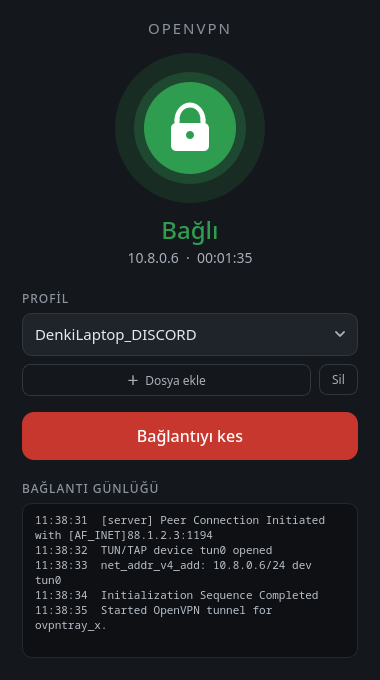

# OVPN Linux (OVPN Tray)

Linux için sade, sistem tepsisinde çalışan bir OpenVPN arayüzü. PyQt6 ile yazıldı, bağlantıları systemd'nin `openvpn-client@` birimleriyle yönetir.



## Özellikler

- İstediğin kadar `.ovpn` profili ekle, açılır listeden seç
- Tek tıkla bağlan / bağlantıyı kes (aynı anda tek profil bağlı olur)
- Bağlanma adımlarını canlı izleyen bağlantı günlüğü
- Durum göstergesi: VPN IP adresi ve bağlantı süresi
- Sistem tepsisinde yuvarlak, renkli durum simgesi ve hızlı bağlanma menüsü
- Pencere kapanınca tepside çalışmaya devam eder

## Kurulum (Arch / CachyOS)

```sh
git clone https://github.com/Denkiyaa/ovpn-linux.git
cd ovpn-linux
sudo ./setup.sh
```

`setup.sh` şunları yapar:

1. `openvpn` ve `python-pyqt6` paketlerini kurar.
2. Bir polkit kuralı ekler: kurulumu yapan kullanıcı, **yalnızca** OVPN Tray'in VPN birimlerini şifre sormadan başlatıp durdurabilir.
3. Başlat menüsüne **OVPN Tray** kısayolunu ekler.

## Nasıl çalışır

- Eklenen profil `/etc/openvpn/client/ovpntray_<ad>.conf` olarak kurulur (`pkexec` ile, bir kez şifre sorar).
- Bağlantı `openvpn-client@ovpntray_<ad>.service` birimiyle açılır; durum `systemctl`, günlük `journalctl` ile okunur.
- Uygulamayı kapatmak VPN'i kesmez; bağlantı systemd tarafından yönetilir.
